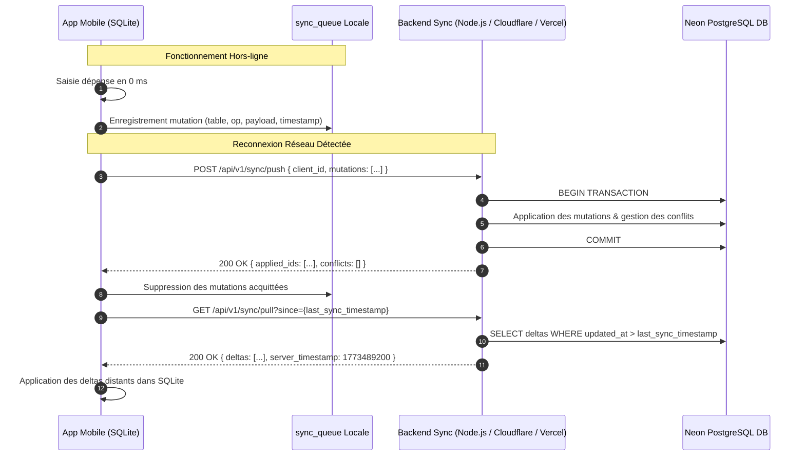

# Spécifications de l'API & Protocole de Synchronisation Cloud — GERETOU
**Contrat d'API REST / WebSocket pour la Synchronisation Neon PostgreSQL (Architecture Offline-First)**

---

## 1. Principes d'Architecture de l'API

L'API de **GERETOU** est une API de synchronisation conçue pour soutenir un fonctionnement **Offline-First strict** :
1. **Zéro dépendance pour les opérations courantes** : L'application n'effectue aucun appel bloquant vers l'API lors d'une saisie de transaction, consultation de solde ou alerte budgétaire.
2. **Synchronisation par Lots (*Batch Delta Sync*)** : Dès que l'appareil détecte le retour d'une connexion réseau fiable, les mutations enregistrées dans la table locale `sync_queue` sont transmises en un seul appel atomique au serveur.
3. **Résolution des Conflits** : Application de la stratégie **LWW (Last-Write-Wins)** enrichie d'horodatages logiques vectoriels (`client_updated_at` et `server_updated_at`).



---

## 2. Authentification & Sécurité des Requêtes

Toutes les requêtes vers l'API nécessitent un en-tête d'authentification Bearer Token :
```http
Authorization: Bearer <JWT_ACCESS_TOKEN>
X-Client-Device-ID: <DEVICE_UUID>
Content-Type: application/json
```

* **Access Token** : JWT d'une durée de vie courte (15 minutes), contenant l'identifiant de l'utilisateur (`user_id`).
* **Refresh Token** : Stocké de manière chiffrée dans le `SecureStore` du smartphone, durée de vie de 90 jours avec rotation automatique à chaque renouvellement.

---

## 3. Endpoints de Synchronisation

### 3.1 Pousser les mutations locales vers le Cloud (`/api/v1/sync/push`)
* **Méthode** : `POST`
* **Description** : Envoie les opérations enregistrées dans la file d'attente locale pendant les périodes hors-ligne.
* **Payload de Requête** :
```json
{
  "client_device_id": "a4f8e912-789a-4c2e-b153-98fe01ab2345",
  "client_sync_timestamp": 1773489200000,
  "mutations": [
    {
      "mutation_id": "mut_01HZX8912AB",
      "table_name": "transactions",
      "operation": "INSERT",
      "record_id": "tx_9812401",
      "timestamp": 1773489150000,
      "data": {
        "id": "tx_9812401",
        "amount": 15000,
        "account_id": "acc_wave_main",
        "category_id": "cat_food",
        "type": "EXPENSE",
        "nature": "REGULAR",
        "urgency": "NORMAL",
        "date": "2026-05-24T11:30:00Z",
        "notes": "Courses marché - Légumes et riz"
      }
    },
    {
      "mutation_id": "mut_01HZX8913CD",
      "table_name": "accounts",
      "operation": "UPDATE",
      "record_id": "acc_wave_main",
      "timestamp": 1773489150000,
      "data": {
        "balance": 135000
      }
    }
  ]
}
```
* **Réponse de Succès (`200 OK`)** :
```json
{
  "status": "SUCCESS",
  "processed_at": 1773489201500,
  "applied_mutations": ["mut_01HZX8912AB", "mut_01HZX8913CD"],
  "conflicts": []
}
```

---

### 3.2 Récupérer les données modifiées depuis le Cloud (`/api/v1/sync/pull`)
* **Méthode** : `GET`
* **Paramètres d'URL** :
  * `since` : Horodatage millisecondes de la dernière synchronisation réussie (ex: `1773480000000`).
* **Réponse de Succès (`200 OK`)** :
```json
{
  "server_timestamp": 1773489250000,
  "deltas": {
    "transactions": [
      {
        "id": "tx_9812500",
        "amount": 25000,
        "account_id": "acc_momo_main",
        "category_id": "cat_sales",
        "type": "INCOME",
        "nature": "REGULAR",
        "date": "2026-05-24T12:00:00Z",
        "updated_at": 1773489230000,
        "_deleted": false
      }
    ],
    "accounts": [],
    "stocks": [
      {
        "id": "stock_riz",
        "current_qty": 2.0,
        "updated_at": 1773489210000,
        "_deleted": false
      }
    ]
  }
}
```

---

## 4. Endpoints d'Authentification & Compte Utilisateur

### 4.1 Enregistrement / Init Compte (`POST /api/v1/auth/register`)
* Initialise l'identifiant utilisateur Cloud avec son e-mail et le hash bcrypt de son code PIN de secours.

### 4.2 Connexion & Échange de Token (`POST /api/v1/auth/login`)
* Vérifie les identifiants et retourne le couple `{ access_token, refresh_token }`.

### 4.3 Renouvellement de Session (`POST /api/v1/auth/refresh`)
* Échange un refresh token valide contre un nouvel access token court.

---

## 5. Endpoints de Sauvegarde Complète (Backup & Restore)

* **`POST /api/v1/backup/create`** : Génère un instantané complet chiffré JSON des données de l'utilisateur stocké sur Neon / Blob Storage.
* **`GET /api/v1/backup/latest`** : Récupère le dernier instantané complet pour restauration intégrale lors d'un changement de téléphone.

---

## 6. Codes d'Erreur & Réponses Standardisées

| Code HTTP | Code Interne | Signification | Conduite de l'App Mobile |
|:---|:---|:---|:---|
| **401** | `AUTH_TOKEN_EXPIRED` | Le token d'accès a expiré | Appel automatique à `/auth/refresh` |
| **403** | `DEVICE_UNAUTHORIZED` | Tentative d'accès depuis un appareil révoqué | Verrouillage et demande du PIN maître |
| **409** | `SYNC_CONFLICT_DETECTED` | Conflit de version sur un enregistrement | Application de la règle LWW |
| **429** | `RATE_LIMIT_EXCEEDED` | Trop de synchronisations rapprochées | Temporisation exponentielle (*Exponential backoff*) |
| **503** | `NEON_MAINTENANCE` | Base Cloud momentanément indisponible | Maintien des données en local sans alerte anxiogène |
