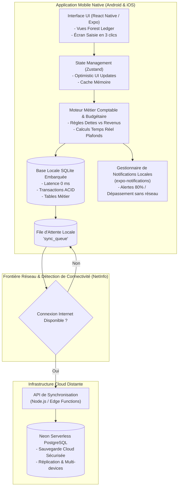

# Architecture Technique & Modèle Offline-First — GERETOU
**Architecture Système, Cycle de Vie des Données et Stratégie de Résilience**

---

## 1. Vue d'Ensemble de l'Architecture

L'application **GERETOU** repose sur une architecture **Offline-First stricte à 3 niveaux** :
1. **Couche Présentation Mobile (React Native / Expo)** : Interface fluide, composable et hautement typée en TypeScript, stylée avec Tailwind/NativeWind selon le design system *Forest Ledger*.
2. **Couche Persistance Locale & Moteur Métier (SQLite Embarqué)** : Garantit une latence de 0 ms, l'intégrité transactionnelle ACID et le calcul autonome des soldes, stocks et budgets.
3. **Couche Synchronisation Distante & Cloud (Neon PostgreSQL)** : Sauvegarde sécurisée et réplication multi-appareils sans jamais bloquer l'usage local.



---

## 2. Le Modèle Offline-First : Cycle de Vie d'une Action

Toute opération dans GERETOU respecte la règle fondamentale : **Le téléphone est la source de vérité immédiate**.

### Déroulement pas-à-pas :
1. **Action Utilisateur** : L'utilisateur appuie sur *« Valider la dépense (15 000 FCFA) »*.
2. **Optimistic UI (0 ms)** : L'interface se met à jour immédiatement, décrémentant visuellement le solde affiché.
3. **Persistance ACID Locale** :
   ```sql
   BEGIN TRANSACTION;
   INSERT INTO transactions (id, amount, account_id, category_id, date, ...) VALUES (...);
   UPDATE accounts SET balance = balance - 15000 WHERE id = 'acc_wave_main';
   INSERT INTO sync_queue (table_name, operation, payload, timestamp) VALUES (...);
   COMMIT;
   ```
4. **Calcul Budgétaire Local** : Le moteur évalue instantanément le pourcentage de consommation du budget du mois.
5. **Déclenchement d'Alerte Locale** : Si le seuil de 80 % ou 100 % est franchi, une notification système native est programmée et émise localement, **même si le téléphone est en mode avion et que l'application est fermée**.
6. **Réplication Différée** : Dès que l'appareil détecte un réseau Wi-Fi ou 4G/5G stable, le worker de synchronisation en arrière-plan dépile la `sync_queue` et l'envoie à Neon.

---

## 3. Gestion d'État Unidirectionnelle (Zustand Store)

Pour éviter les cascades de re-renders et garantir une réactivité maximale sur des téléphones d'entrée ou de milieu de gamme :
* **Store Trésorerie (`useWalletStore`)** : Gère les soldes consolidés, les comptes Wave, MoMo, Orange et Cash.
* **Store Budgets (`useBudgetStore`)** : Gère les plafonds mensuels et journaliers et les statuts des jauges.
* **Store Stocks (`useStockStore`)** : Gère l'inventaire des consommables et la génération dynamique du panier de courses.
* **Store Dettes & Projets (`useEngagementsStore`)** : Gère les créances actives, les dettes et les cagnottes d'épargne dédiées.

---

## 4. Stratégie de Résolution des Conflits de Synchronisation

Dans une architecture multi-appareils hors-ligne, des modifications concurrentes peuvent survenir :
* **Cas des Transactions** : Aucune collision possible car chaque transaction possède un UUID unique (`tx_<uuid>`). Deux dépenses saisies hors-ligne s'additionnent naturellement.
* **Cas des Comptes & Soldes** : Le solde n'est jamais synchronisé comme une valeur brute absolue, mais comme le résultat de la somme des deltas de transactions.
* **Cas des Stocks** : Application de la stratégie **LWW (Last-Write-Wins)** basée sur l'horodatage vectoriel le plus récent.
* **Suppression Sécurisée** : Suppression logique (*Soft Delete* avec flag `_deleted: true`) pour propager la suppression sans causer d'incohérences relationnelles.

---

## 5. Gestion de l'Énergie et des Performances

* **Zéro Polling** : Pas de requêtes réseau répétitives en boucle. L'application écoute les événements de connectivité du système d'exploitation (`NetInfo.addEventListener`).
* **Indexation SQLite** : Toutes les requêtes de dashboard (somme des dépenses du mois en cours) s'exécutent sur des colonnes indexées (`CREATE INDEX idx_tx_date ON transactions(date)`), assurant un temps d'exécution < 5 ms même avec 50 000 lignes d'historique.
* **Taille de Bundle Minimale** : Aucune dépendance lourde inutile ; utilisation des primitives natives Expo.
