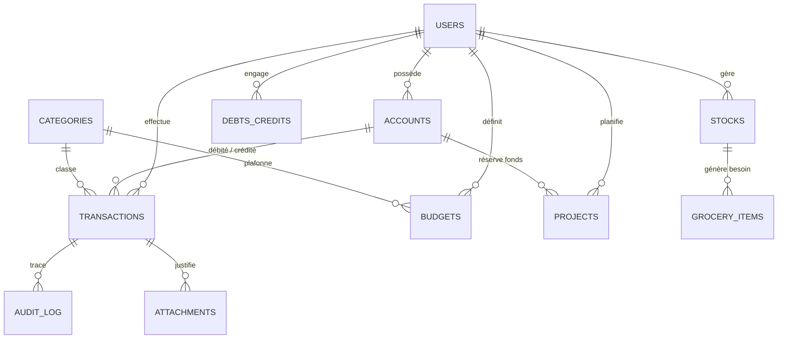

# Schéma Relationnel de la Base de Données — GERETOU
**Spécifications DDL pour SQLite Embarqué (Local) et Neon PostgreSQL (Cloud)**

---

## 1. Diagramme Entité-Association (ERD)



---

## 2. Définition des Tables et Schéma DDL

### Table 1 : `users` (Profils & Sécurité)
```sql
CREATE TABLE IF NOT EXISTS users (
    id TEXT PRIMARY KEY,
    email TEXT UNIQUE NOT NULL,
    pin_hash TEXT NOT NULL,
    biometric_enabled INTEGER DEFAULT 0,
    created_at TIMESTAMP DEFAULT CURRENT_TIMESTAMP,
    updated_at TIMESTAMP DEFAULT CURRENT_TIMESTAMP
);
```

---

### Table 2 : `accounts` (Portefeuilles & Mobile Money)
```sql
CREATE TABLE IF NOT EXISTS accounts (
    id TEXT PRIMARY KEY,
    user_id TEXT NOT NULL,
    name TEXT NOT NULL, -- Ex: 'Wave Principal', 'MTN MoMo Épargne'
    type TEXT NOT NULL CHECK (type IN ('WAVE', 'MOMO', 'ORANGE', 'CASH', 'BANK', 'VAULT')),
    sub_type TEXT NOT NULL DEFAULT 'MAIN' CHECK (sub_type IN ('MAIN', 'VAULT', 'SAVINGS')),
    balance REAL NOT NULL DEFAULT 0.0,
    currency TEXT NOT NULL DEFAULT 'FCFA',
    is_archived INTEGER DEFAULT 0,
    created_at TIMESTAMP DEFAULT CURRENT_TIMESTAMP,
    updated_at TIMESTAMP DEFAULT CURRENT_TIMESTAMP,
    FOREIGN KEY (user_id) REFERENCES users(id) ON DELETE CASCADE
);

CREATE INDEX idx_accounts_user ON accounts(user_id);
```

---

### Table 3 : `categories` (Catégories Métier)
```sql
CREATE TABLE IF NOT EXISTS categories (
    id TEXT PRIMARY KEY,
    name TEXT NOT NULL, -- Ex: 'Alimentation & Marché', 'Transport'
    icon TEXT NOT NULL, -- Nom de l'icône Material
    color TEXT NOT NULL, -- Hex couleur (ex: '#0B4F3A')
    type TEXT NOT NULL CHECK (type IN ('EXPENSE', 'INCOME', 'BOTH')),
    is_default INTEGER DEFAULT 0,
    created_at TIMESTAMP DEFAULT CURRENT_TIMESTAMP
);
```

---

### Table 4 : `transactions` (Dépenses, Recettes & Virements)
```sql
CREATE TABLE IF NOT EXISTS transactions (
    id TEXT PRIMARY KEY,
    user_id TEXT NOT NULL,
    amount REAL NOT NULL,
    account_id TEXT NOT NULL,
    destination_account_id TEXT, -- Renseigné uniquement pour les virements internes
    category_id TEXT,
    type TEXT NOT NULL CHECK (type IN ('EXPENSE', 'INCOME', 'TRANSFER')),
    nature TEXT NOT NULL DEFAULT 'REGULAR' CHECK (nature IN ('REGULAR', 'UNEXPECTED', 'REIMBURSABLE')),
    urgency TEXT NOT NULL DEFAULT 'NORMAL' CHECK (urgency IN ('LOW', 'NORMAL', 'HIGH', 'CRITICAL')),
    provenance TEXT, -- 'SALARY', 'FREELANCE', 'GIFT', 'SALE', 'LOAN', 'OTHER'
    date TIMESTAMP NOT NULL,
    notes TEXT,
    receipt_uri TEXT, -- Chemin local de la photo du reçu
    is_deleted INTEGER DEFAULT 0,
    created_at TIMESTAMP DEFAULT CURRENT_TIMESTAMP,
    updated_at TIMESTAMP DEFAULT CURRENT_TIMESTAMP,
    FOREIGN KEY (user_id) REFERENCES users(id) ON DELETE CASCADE,
    FOREIGN KEY (account_id) REFERENCES accounts(id) ON DELETE RESTRICT,
    FOREIGN KEY (destination_account_id) REFERENCES accounts(id) ON DELETE SET NULL,
    FOREIGN KEY (category_id) REFERENCES categories(id) ON DELETE SET NULL
);

CREATE INDEX idx_tx_date ON transactions(date);
CREATE INDEX idx_tx_account ON transactions(account_id);
CREATE INDEX idx_tx_category ON transactions(category_id);
```

---

### Table 5 : `budgets` (Plafonds & Alertes)
```sql
CREATE TABLE IF NOT EXISTS budgets (
    id TEXT PRIMARY KEY,
    user_id TEXT NOT NULL,
    period TEXT NOT NULL CHECK (period IN ('DAY', 'MONTH', 'YEAR')),
    category_id TEXT, -- NULL pour budget global, id catégorie pour budget spécifique
    limit_amount REAL NOT NULL,
    alert_threshold REAL NOT NULL DEFAULT 0.80, -- Alerte dès 80 % atteint
    is_active INTEGER DEFAULT 1,
    created_at TIMESTAMP DEFAULT CURRENT_TIMESTAMP,
    FOREIGN KEY (user_id) REFERENCES users(id) ON DELETE CASCADE,
    FOREIGN KEY (category_id) REFERENCES categories(id) ON DELETE CASCADE
);
```

---

### Table 6 : `stocks` (Consommables Domestiques)
```sql
CREATE TABLE IF NOT EXISTS stocks (
    id TEXT PRIMARY KEY,
    user_id TEXT NOT NULL,
    name TEXT NOT NULL, -- Ex: 'Riz Parfumé 25kg', 'Huile de table'
    category TEXT NOT NULL, -- 'Alimentation', 'Hygiène', 'Entretien'
    current_qty REAL NOT NULL DEFAULT 0.0,
    unit TEXT NOT NULL, -- 'kg', 'L', 'morceau', 'boîte', 'paquet'
    min_threshold REAL NOT NULL DEFAULT 1.0, -- Seuil d'alerte critique
    estimated_unit_price REAL, -- Prix moyen estimé en FCFA
    created_at TIMESTAMP DEFAULT CURRENT_TIMESTAMP,
    updated_at TIMESTAMP DEFAULT CURRENT_TIMESTAMP,
    FOREIGN KEY (user_id) REFERENCES users(id) ON DELETE CASCADE
);

CREATE INDEX idx_stocks_user ON stocks(user_id);
```

---

### Table 7 : `grocery_items` (Panier de Courses Automatique)
```sql
CREATE TABLE IF NOT EXISTS grocery_items (
    id TEXT PRIMARY KEY,
    stock_id TEXT NOT NULL,
    needed_qty REAL NOT NULL,
    estimated_total_price REAL,
    is_purchased INTEGER DEFAULT 0,
    created_at TIMESTAMP DEFAULT CURRENT_TIMESTAMP,
    FOREIGN KEY (stock_id) REFERENCES stocks(id) ON DELETE CASCADE
);
```

---

### Table 8 : `debts_credits` (Dettes & Créances)
```sql
CREATE TABLE IF NOT EXISTS debts_credits (
    id TEXT PRIMARY KEY,
    user_id TEXT NOT NULL,
    type TEXT NOT NULL CHECK (type IN ('DEBT', 'CREDIT')), -- DEBT = Vous devez, CREDIT = On vous doit
    person_name TEXT NOT NULL,
    phone_number TEXT,
    initial_amount REAL NOT NULL,
    remaining_amount REAL NOT NULL,
    due_date DATE,
    status TEXT NOT NULL DEFAULT 'PENDING' CHECK (status IN ('PENDING', 'PARTIAL', 'SETTLED', 'DEFAULTED')),
    notes TEXT,
    created_at TIMESTAMP DEFAULT CURRENT_TIMESTAMP,
    updated_at TIMESTAMP DEFAULT CURRENT_TIMESTAMP,
    FOREIGN KEY (user_id) REFERENCES users(id) ON DELETE CASCADE
);

CREATE INDEX idx_debts_status ON debts_credits(status);
```

---

### Table 9 : `projects` (Cagnottes d'Achat & Épargne Dédiée)
```sql
CREATE TABLE IF NOT EXISTS projects (
    id TEXT PRIMARY KEY,
    user_id TEXT NOT NULL,
    title TEXT NOT NULL, -- Ex: 'Ordinateur Portable Pro'
    description TEXT,
    target_amount REAL NOT NULL,
    locked_amount REAL NOT NULL DEFAULT 0.0, -- Argent physiquement bloqué dans un coffre
    account_vault_id TEXT, -- Référence au coffre Wave ou compte épargne assigné
    target_date DATE,
    priority TEXT NOT NULL DEFAULT 'MEDIUM' CHECK (priority IN ('LOW', 'MEDIUM', 'HIGH', 'CRITICAL')),
    status TEXT NOT NULL DEFAULT 'ACTIVE' CHECK (status IN ('IDEA', 'ACTIVE', 'COMPLETED', 'ABANDONED')),
    created_at TIMESTAMP DEFAULT CURRENT_TIMESTAMP,
    updated_at TIMESTAMP DEFAULT CURRENT_TIMESTAMP,
    FOREIGN KEY (user_id) REFERENCES users(id) ON DELETE CASCADE,
    FOREIGN KEY (account_vault_id) REFERENCES accounts(id) ON DELETE SET NULL
);
```

---

### Table 10 : `sync_queue` (File d'Attente de Synchronisation Locale)
```sql
CREATE TABLE IF NOT EXISTS sync_queue (
    id INTEGER PRIMARY KEY AUTOINCREMENT,
    mutation_id TEXT UNIQUE NOT NULL,
    table_name TEXT NOT NULL,
    operation TEXT NOT NULL CHECK (operation IN ('INSERT', 'UPDATE', 'DELETE')),
    record_id TEXT NOT NULL,
    payload TEXT NOT NULL, -- Données sérialisées en JSON
    timestamp INTEGER NOT NULL, -- Horodatage millisecondes
    retry_count INTEGER DEFAULT 0,
    status TEXT NOT NULL DEFAULT 'PENDING' CHECK (status IN ('PENDING', 'PROCESSING', 'FAILED'))
);

CREATE INDEX idx_sync_status ON sync_queue(status, timestamp);
```

---

### Table 11 : `audit_log` (Journal d'Intégrité Comptable)
```sql
CREATE TABLE IF NOT EXISTS audit_log (
    id INTEGER PRIMARY KEY AUTOINCREMENT,
    transaction_id TEXT NOT NULL,
    action TEXT NOT NULL CHECK (action IN ('CREATE', 'UPDATE', 'DELETE')),
    old_data TEXT, -- Snapshot JSON avant modification
    new_data TEXT, -- Snapshot JSON après modification
    reason TEXT,
    modified_at TIMESTAMP DEFAULT CURRENT_TIMESTAMP
);

CREATE INDEX idx_audit_tx ON audit_log(transaction_id);
```
