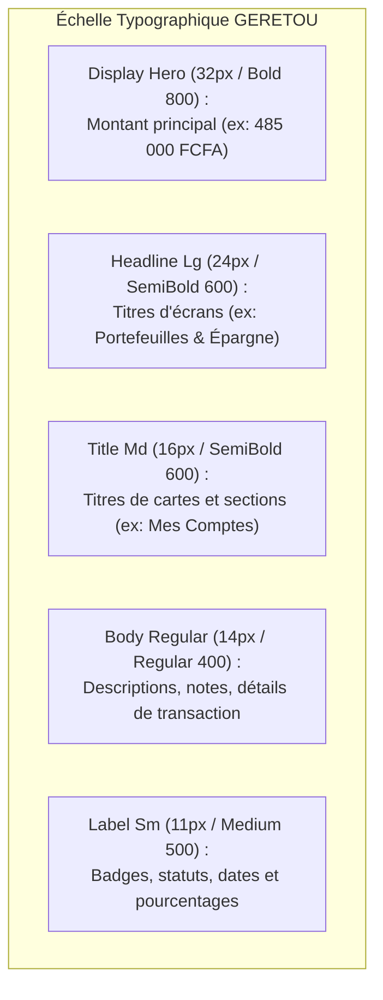

# Spécifications du Design System — Forest Ledger
**Charte Graphique Mobile, Tokens de Style, Typographie et Ergonomie Visuelle pour GERETOU**

---

## 1. Philosophie & Règle Anti-Surcharge

L'interface de **GERETOU** s'adresse à des utilisateurs qui consultent leur solde et leurs dépenses dans toutes les conditions (lumière vive du soleil au marché, fatigue en fin de journée, écrans de smartphones d'entrée de gamme). 

### Principes Directeurs :
1. **Zéro Dégradé Kitsch / Zéro Flou Visuel** : Aucun effet de verre fumé lourd, aucune ombre portée démesurée, pas de dégradés multicolores criards.
2. **Palette Resserrée et Épurée** : 4 couleurs maîtresses fortes, bien contrastées, immédiatement identifiables.
3. **Bords Nets & Rigueur Géométrique** : Rayons de courbure maîtrisés à **8px (`rounded-md`)**, évitant l'effet "bulle de savon" enfantin.
4. **Typographie Tabulaire Haute Visibilité** : Chiffres monétaires lisibles en un coup d'œil, toujours formatés en FCFA avec espace insécable.

---

## 2. Palette Chromatique Officielle

| Token | Hexadécimal | Nom | Rôle Métier |
|:---|:---|:---|:---|
| `primary` | `#0B4F3A` | Vert Forêt Profond | Couleur d'ancrage, stabilité, cartes de solde principal, boutons d'action majeurs. |
| `primary-container` | `#D1E7DD` | Vert d'Eau / Menthe douce | Fond des puces actives, badges de confirmation, état sélectionné des catégories. |
| `accent-amber` | `#F59E0B` | Jaune Ambre / Or | Alertes de budget (80%), épargne de projet, rappel de factures, attention requise. |
| `status-danger` | `#EF4444` | Rouge Corail | Dépassement budgétaire, rupture de stock, dettes exigibles, bouton d'annulation critique. |
| `status-success` | `#10B981` | Vert Émeraude | Entrées d'argent réelles, solde positif, créances remboursées, stock suffisant. |
| `surface-canvas` | `#F8FAFC` | Ardoise Givré (Fond) | Arrière-plan global de l'application (glare-resistant). |
| `surface-card` | `#FFFFFF` | Blanc Pur | Cartes de transactions, formulaires, tiroirs d'action, entrées de texte. |
| `text-primary` | `#0F172A` | Bleu Ardoise Nuit | Titres, gros montants numériques, textes à fort contraste. |
| `text-muted` | `#64748B` | Gris Acier Neutre | Sous-titres, dates, légendes, libellés secondaires. |
| `border-hairline` | `#E2E8F0` | Bordure Fine (1px) | Séparateur net des cartes et cellules sans ajouter de bruit visuel. |

---

## 3. Typographie : *Plus Jakarta Sans*

La typographie est choisie pour sa clarté géométrique et son exceptionnelle lisibilité sur petit écran :

### Règle Strictement Obligatoire pour les Montants :
* **Propriété CSS** : `font-variant-numeric: tabular-nums;`
* Tous les chiffres de prix et de solde doivent être alignés verticalement, avec séparateur de milliers (espace fine ou standard) :
  * ✅ `15 000 FCFA` (Correct)
  * ❌ `15000FCFA` ou `15,000.00 F` (Proscrit)

---

## 4. Composants & Spécifications Visuelles

### 4.1 Boutons Primaires
* **Hauteur minimale** : `48px` (zone tactile confortable pour utilisation à une main).
* **Fond** : `#0B4F3A`, texte `#FFFFFF`, graisse `SemiBold 600`.
* **Rayon de courbure** : `8px` (`rounded-md`).
* **Effet au toucher** : Réduction subtile d'échelle (`active:scale-98`) avec légère vibration haptique.

### 4.2 Bouton Central Flottant (Floating Action Button - FAB)
* **Dimensions** : `56px x 56px`, cercle parfait (`rounded-full`).
* **Position** : Centré dans la barre de navigation inférieure, légèrement surélevé de `16px`.
* **Couleur** : Vert Forêt `#0B4F3A` avec icône `+` en gras `#FFFFFF`.
* **Rôle** : Déclencheur universel de saisie rapide (accès en 1 clic au formulaire de dépense).

### 4.3 Cartes & Conteneurs (Cards)
* **Fond** : `#FFFFFF`.
* **Bordure** : `1px solid #E2E8F0`.
* **Ombre** : Légère et discrète (`box-shadow: 0 1px 3px rgba(15, 23, 42, 0.05)`). Pas d'ombre floue étalée.
* **Padding interne** : `16px` (`p-4`).

### 4.4 Badges de Statut (Status Pills)
* **Hauteur** : `24px`, rayon `12px` (`rounded-full`).
* **Padding** : `px-2.5 py-0.5`.
* **Variantes** :
  * *Hors-ligne / Prêt* : Fond `#FEF3C7`, texte `#B45309`.
  * *Succès / Payé* : Fond `#D1E7DD`, texte `#0B4F3A`.
  * *Alerte 80%* : Fond `#FFFBEB`, texte `#D97706`.
  * *Rupture / Dette* : Fond `#FEE2E2`, texte `#B91C1C`.
