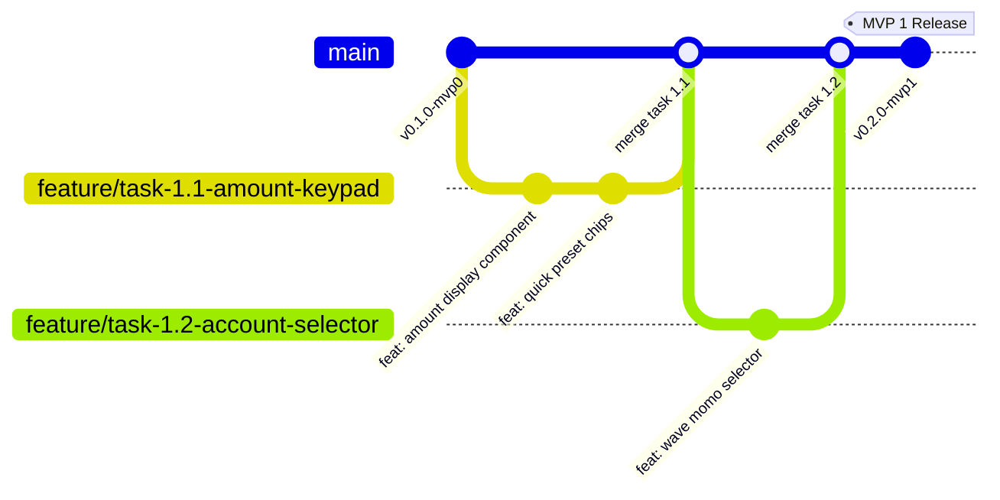

# Conventions Git & Guide de Contribution — GERETOU
**Normes de Branches, Format des Commits Conventionnels et Workflow de Développement**

---

## 1. Modèle de Gestion des Branches (*Git Flow Adapté*)

Pour garantir une stabilité continue à chaque étape du développement avec Antigravity :



* **`main`** : Branche principale protégée. Chaque commit sur `main` doit compiler, passer tous les tests unitaires et correspondre à une tâche finie et stable.
* **`feature/<id-tâche>-<nom-court>`** : Branche de travail dédiée à une tâche ou micro-tâche spécifique (ex: `feature/task-1.1-amount-keypad`).
* **`fix/<nom-bug>`** : Branche de correction de bug ou d'ajustement.

---

## 2. Format des Messages de Commit (*Conventional Commits*)

Chaque message de commit doit être explicite, concis et préfixé par son type :

```
<type>(<portée>): <description courte et impérative>

[Corps optionnel expliquant le pourquoi et les choix techniques]
```

### Types Autorisés :
* **`feat`** : Nouvelle fonctionnalité visible pour l'utilisateur (ex: `feat(expenses): add 3-click fast entry screen`).
* **`fix`** : Correction de bug (ex: `fix(accounting): prevent loan income from inflating net balance`).
* **`task`** : Finalisation d'une micro-tâche unitaire (ex: `task(ui): implement forest ledger button state`).
* **`refactor`** : Refactorisation de code sans modification fonctionnelle (ex: `refactor(db): optimize sqlite queries with indexes`).
* **`docs`** : Mise à jour ou création de documentation (ex: `docs(api): define sync push and pull schemas`).
* **`test`** : Ajout ou correction de tests unitaires (ex: `test(budget): add 80 percent threshold alert test`).
* **`chore`** : Tâche de maintenance ou mise à jour de dépendances (ex: `chore: configure eas build profiles`).

---

## 3. Checklist Avant Merge / Validation de Tâche

Avant de déclarer une tâche ou micro-tâche comme terminée :
- [ ] Le code respecte TypeScript strict (zéro `any` implicite).
- [ ] Tous les composants sont complètement stylés avec les tokens *Forest Ledger*.
- [ ] Chaque bouton a une action réelle câblée (pas de bouton vide ni d'alerte factice).
- [ ] Les tests unitaires associés passent au vert (`npm test`).
- [ ] Aucune erreur ni avertissement critique dans la console Expo.
