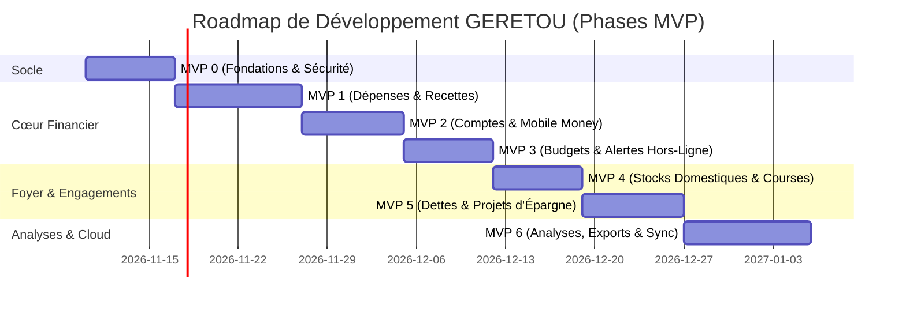

# Roadmap des MVPs — GERETOU
**Feuille de Route Incrémentale et Critères d'Acceptation par Phase**

---

## Vue d'Ensemble des Jalons

---

## 1. MVP 0 : Socle Technique, Sécurité & Design System
* **Périmètre** :
  * Initialisation du projet Expo / React Native avec TypeScript strict.
  * Mise en place du Design System *Forest Ledger* (tokens Tailwind / NativeWind).
  * Configuration du stockage sécurisé local (`expo-sqlite` avec transactions ACID et `expo-secure-store`).
  * Module d'authentification initiale : écran de création et de vérification du code PIN à 4/6 chiffres (haché par bcrypt) + support biométrique (Face ID / Empreinte).
  * Structure du layout sécurisé et barre de navigation maîtresse.
* **Critères d'Acceptation** :
  * [x] L'application se lance sur simulateur / smartphone sans aucune erreur console.
  * [x] L'utilisateur peut créer son code PIN, verrouiller l'application, et la déverrouiller avec succès.
  * [x] Un code PIN erroné 3 fois consécutives déclenche un délai de sécurité.
  * [x] La base SQLite locale est initialisée avec le schéma de tables de base.

---

## 2. MVP 1 : Cœur Financier (Dépenses, Recettes & Règle Comptable)
* **Périmètre** :
  * Écran d'Accueil / Tableau de bord avec affichage du solde total et des dernières transactions.
  * Écran de Saisie Dépense (Fast 3-click entry) avec grand pavé numérique et presets (+1k, +5k, +10k).
  * Écran de Saisie Recette avec sélection obligatoire de provenance.
  * Implémentation de la règle comptable stricte : si provenance = *Crédit/Emprunt*, bascule automatique vers le module des dettes sans gonfler le revenu d'exploitation.
  * Gestion des catégories par défaut et tags dynamiques.
* **Critères d'Acceptation** :
  * [x] L'utilisateur peut enregistrer une dépense en moins de 5 secondes.
  * [x] Le solde total disponible est recalculé instantanément (0 ms) sans rechargement.
  * [x] Fonctionnement complet en mode avion (zéro appel réseau nécessaire).
  * [x] L'historique des opérations est consultable et triable.

---

## 3. MVP 2 : Multi-Comptes & Mobile Money Spécifique
* **Périmètre** :
  * Gestion illimitée des comptes : Wave, MTN MoMo, Orange Money, Banques, Espèces.
  * Gestion des **Coffres Wave** (sous-comptes internes verrouillés).
  * Gestion des sous-comptes **MoMo Épargne**.
  * Module de **Virement Interne Neutre** (transfert de Wave vers MoMo avec frais optionnels, sans altérer les agrégats de dépenses ou recettes).
  * Répartition consolidée : Liquidités disponibles vs Fonds réservés.
* **Critères d'Acceptation** :
  * [x] Création, modification et archivage d'un compte sans perte d'historique.
  * [x] Exécution d'un virement interne avec débit/crédit atomique sous transaction SQLite.
  * [x] Les graphiques de dépenses excluent rigoureusement les virements internes.

---

## 4. MVP 3 : Suivi Budgétaire & Alertes Hors-Ligne
* **Périmètre** :
  * Définition des plafonds mensuels et journaliers (globaux et par catégorie).
  * Calcul en temps réel de la consommation budgétaire et du reste à dépenser.
  * Moteur de notifications push locales (`expo-notifications`) fonctionnant application fermée et téléphone hors-ligne.
  * Seuils d'alerte configurables (ex: 80 % ou 85 % atteint, et 100 % dépassement).
* **Critères d'Acceptation** :
  * [x] Dès qu'une dépense franchit le seuil de 80 %, une notification locale est émise sur l'appareil.
  * [x] Les jauges visuelles s'animent et passent du vert au jaune ambre puis au rouge.

---

## 5. MVP 4 : Stocks Domestiques & Liste de Courses
* **Périmètre** :
  * Gestion des consommables du foyer (nom, unité, quantité actuelle, seuil minimum).
  * Calcul dynamique du statut : `OK`, `Stock bas`, `Rupture`.
  * Génération automatique du panier de courses valorisé en FCFA.
  * Action de réapprovisionnement : transformer les courses achetées en dépense réelle tout en réincrémentant les stocks.
* **Critères d'Acceptation** :
  * [x] Un produit à quantité 0 passe instantanément en statut *Rupture totale*.
  * [x] L'onglet liste de courses isole uniquement les produits à réapprovisionner.
  * [x] L'achat groupé met à jour les stocks et enregistre la dépense dans le portefeuille choisi.

---

## 6. MVP 5 : Dettes, Créances & Projets d'Achat
* **Périmètre** :
  * Module Créances (qui vous doit de l'argent) avec gestion des remboursements partiels.
  * Module Dettes (ce que vous devez rembourser) avec échéancier.
  * Module Projets d'Achat (cagnottes cibles avec argent physiquement bloqué dans un coffre dédié).
  * Calcul de la balance nette des engagements (+ Créances - Dettes).
* **Critères d'Acceptation** :
  * [x] Enregistrer un remboursement partiel réduit fidèlement le montant restant dû.
  * [x] Le solde disponible n'est déduit que du montant réellement bloqué dans le coffre du projet.

---

## 7. MVP 6 : Analyses, Exports & Synchronisation Cloud Neon
* **Périmètre** :
  * Dashboard analytique avec graphiques (évolution 30j, répartition circulaire par catégorie).
  * Bilan automatique de fin de mois avec diagnostic de gestion.
  * Exports de données au format PDF, Excel (.xlsx) et CSV.
  * Synchronisation bidirectionnelle avec le Cloud Neon (PostgreSQL) via la table `sync_queue`.
  * Détection automatique du retour du réseau pour synchronisation transparente en arrière-plan.
* **Critères d'Acceptation** :
  * [x] Les exports PDF et Excel sont générés localement et partageables via WhatsApp ou e-mail.
  * [x] Les transactions saisies hors-ligne sont répliquées sur Neon dès la reconnexion sans doublon.
