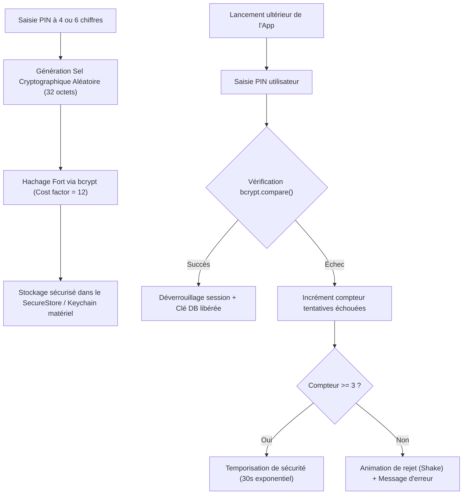

# Modèle de Sécurité & Protection des Données — GERETOU
**Normes de Sécurité Mobile, Chiffrement Local, Intégrité Comptable et Prévention des Menaces**

---

## 1. Principes Fondamentaux de Sécurité

Dans une application financière gérant de la trésorerie réelle (Mobile Money, soldes bancaires, créances), la sécurité ne doit jamais être un ajout tardif, mais le cœur du système :
1. **Protection contre l'Accès Physique Non Autorisé** : Si le téléphone est prêté, égaré ou dérobé, aucune donnée financière ne doit être lisible en clair.
2. **Intégrité Cryptographique des Mots de Passe & PIN** : Aucun mot de passe ni code PIN n'est jamais stocké en clair, ni en local ni sur le serveur.
3. **Isolation des Données Locales** : Base de données SQLite chiffrée via `SQLCipher` ou conteneur `expo-secure-store`.
4. **Zéro Payload Non Maîtrisé** : Validation stricte de tous les schémas d'entrée avec Zod.
5. **Prévention des Attaques IDOR (Insecure Direct Object Reference)** : Chaque requête de synchronisation ou de lecture Cloud vérifie rigoureusement l'appartenance de la ressource au `user_id` authentifié.

---

## 2. Modèle d'Authentification : Code PIN & Biométrie



### Paramètres de Configuration :
* **Algorithme de Hachage** : `bcrypt` (facteur de coût $12$).
* **Biométrie** : `expo-local-authentication` configuré en mode `AuthenticationType.BIOMETRICS`. La biométrie ne remplace pas le PIN maître : elle déverrouille un secret éphémère qui valide le PIN stocké dans le trousseau matériel (iOS Secure Enclave / Android Keystore).
* **Verrouillage de Session Automatique** :
  * Si l'application passe en arrière-plan pendant plus de **180 secondes (3 minutes)**, la session est invalidée en mémoire et le prompt de sécurité s'affiche immédiatement au retour au premier plan.
  * Masquage de l'aperçu de l'écran dans le sélecteur d'applications (*App Switcher Obscuration*) pour éviter les fuites visuelles de solde.

### Procédure de Récupération du PIN Oublié (Option B Validée) :
* En cas d'oubli du code PIN, l'utilisateur clique sur le lien *« Code PIN oublié ? »*.
* **Fonctionnement** :
  1. Si une connexion Internet est disponible : un e-mail contenant un jeton cryptographique à usage unique (OTP de 6 chiffres valable 15 minutes) est expédié à l'adresse e-mail vérifiée du compte.
  2. Si le téléphone est hors-ligne : l'application informe l'utilisateur que la demande de réinitialisation est enregistrée et sera traitée dès le rétablissement de la connexion.
  3. Dès validation du code OTP reçu par e-mail, l'ancien hash bcrypt est révoqué et l'utilisateur est invité à définir son nouveau code PIN en 2 étapes (saisie + confirmation).

---

## 3. Chiffrement des Données Embarquées

### 3.1 Clés de Chiffrement & SecureStore
* Les tokens de session (`refresh_token`) et les clés secrètes locales sont stockés dans le coffre-fort matériel :
  * **iOS** : `Keychain Services` avec attribut `kSecAttrAccessibleAfterFirstUnlockThisDeviceOnly`.
  * **Android** : `EncryptedSharedPreferences` appuyé sur le `KeyStore` matériel.

### 3.2 Fichiers Justificatifs (Photos de Reçus)
* Les photos de tickets de caisse ou factures prises depuis l'appareil sont stockées dans le répertoire privé de l'application (`FileSystem.documentDirectory/vault/`) inaccessible aux autres applications du système ou à la galerie publique.

---

## 4. Prévention des Vulnérabilités & Menaces Web / Cloud

| Menace | Vecteur d'attaque | Mesure de Protection GERETOU |
|:---|:---|:---|
| **Injections SQL** | Champs de description, montants, noms de contacts | Requêtes préparées paramétrées obligatoires (`db.runAsync(sql, [params])`) sans aucune concaténation directe de chaîne. |
| **IDOR (Vol de données)** | Manipulation de `account_id` ou `tx_id` lors de la sync | Validation côté serveur : chaque mutation vérifie que `record.user_id === jwt.user_id`. |
| **Man-in-the-Middle (MitM)** | Interception réseau sur Wi-Fi public | HTTPS strict, TLS 1.3 obligatoire, SSL Pinning sur les requêtes vers l'API Neon de production. |
| **Déni de Service / Brute Force** | Tentatives répétées de devinette de PIN | Blocage exponentiel local + Rate Limiting Cloud (max 5 tentatives par minute par IP). |
| **Piratage d'Historique** | Modification frauduleuse d'une transaction passée | Table d'audit `audit_log` en append-only non supprimable retraçant chaque édition ou annulation. |

---

## 5. Rigueur Comptable & Anti-Corruption de Données

Les erreurs d'intégrité comptable peuvent être destructrices pour la confiance de l'utilisateur :
1. **Transactions Atomiques (ACID)** :
   * Toute opération financière (ex: enregistrer une dépense de 15 000 FCFA sur Wave) est enveloppée dans une transaction SQL :
     ```sql
     BEGIN TRANSACTION;
     -- Étape 1 : insérer la dépense
     -- Étape 2 : réduire le solde Wave
     -- Étape 3 : enregistrer la ligne dans la file de sync
     COMMIT;
     ```
   * Si une panne d'alimentation ou un crash survient pendant l'écriture, la transaction est annulée en totalité (`ROLLBACK`), évitant tout solde désynchronisé.
2. **Immuabilité de l'Épargne Bloquée** :
   * Le montant des cagnottes de projets verrouillées dans un coffre ne peut jamais être dépensé silencieusement sans une action explicite de déverrouillage de coffre.
