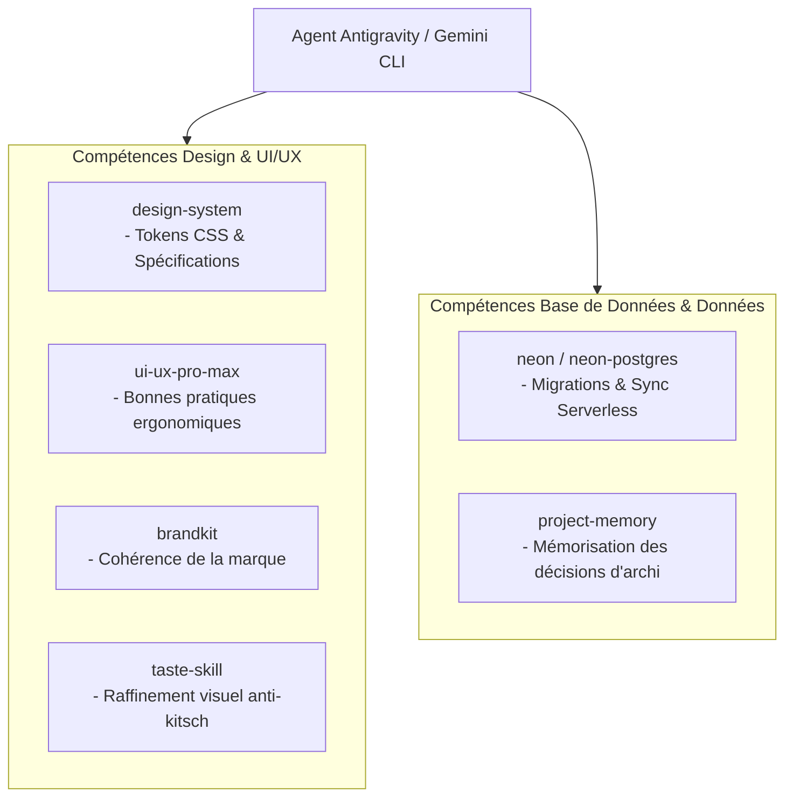

# Guide des Skills Antigravity — GERETOU
**Mode d'Emploi des Compétences Autonomes Intégrées au Projet**

---

## 1. Rôle des Skills dans le Projet GERETOU

Le dossier [`skills/`](file:///C:/Users/Toto.ADMINISTRATOR/Desktop/Projects/PROJECT%20PARTENAIRE/SACHAT%20PROJECTS/GETOU/skills) contient l'ensemble des compétences et directives spécialisées chargées automatiquement par **Antigravity**. Elles encadrent la qualité, le design, la sécurité et la persistance des données.

---

## 2. Inventaire et Utilisation des Skills Clés

### 2.1 `skills/ui-ux-pro-max` & `skills/taste-skill`
* **Rôle** : Garantir une esthétique mobile moderne, mature et professionnelle.
* **Directives appliquées** :
  * Pas d'éléments graphiques "gadgets" ni de dégradés multicolores flous.
  * Respect des contrastes de lisibilité WCAG AA (lisible en plein soleil sur les marchés d'Abidjan ou Dakar).
  * Rayons de courbure modérés (`rounded-md`, 8px) pour conserver une rigueur financière.
  * Hiérarchie claire : un seul bouton d'action principale par écran.

### 2.2 `skills/design-system` & `skills/brandkit`
* **Rôle** : Fournir la source unique de vérité pour les tokens de style :
  * Vert Forêt (`#0B4F3A`)
  * Jaune Ambre (`#F59E0B`)
  * Rouge Corail (`#EF4444`)
  * Vert Émeraude (`#10B981`)
  * Ardoise (`#0F172A`)
  * Blanc pur (`#FFFFFF`)

### 2.3 `skills/neon` & `skills/neon-postgres`
* **Rôle** : Encadrer les requêtes SQL, la création des schémas et la synchronisation avec le Cloud Neon Serverless PostgreSQL.
* **Directives appliquées** :
  * Requêtes préparées systématiques contre les injections SQL.
  * Indexation intelligente des colonnes critiques (`user_id`, `date`, `account_id`).
  * Gestion propre des transactions ACID et du branching de base de données.

### 2.4 `skills/project-memory`
* **Rôle** : Conserver la trace des décisions architecturales non négociables :
  1. *Un emprunt/crédit n'est pas un revenu.*
  2. *Les projets d'achat prévisionnels ne réduisent pas le solde disponible (seul l'argent physiquement bloqué l'est).*
  3. *L'application fonctionne à 100 % hors-ligne.*
