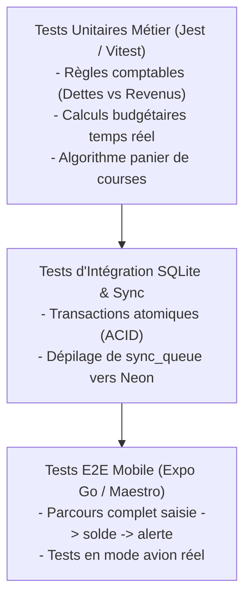

# Stratégie de Tests & Assurance Qualité — GERETOU
**Plan de Couverture des Tests Unitaires, d'Intégration SQLite, Hors-Ligne et E2E Mobile**

---

## 1. Pyramide de Tests pour une Application Offline-First



---

## 2. Tests Unitaires Métier (Obligatoires & Rigoureux)

Ces tests vérifient que la logique métier comptable est infaillible, sans dépendance à l'interface graphique :

### 2.1 Suite : Règles Comptables & Provenance
* **Test 1.1** : *« Un gain de type 'SALARY' ou 'FREELANCE' incrémente le revenu net et le solde du compte »*.
* **Test 1.2** : *« Un gain de type 'LOAN' (Crédit/Emprunt) incrémente le solde du compte récepteur MAIS crée une ligne de Dette et n'augmente PAS le revenu net d'activité »*.
* **Test 1.3** : *« Un virement interne de Wave vers MoMo conserve le patrimoine total inchangé et n'ajoute aucune ligne aux dépenses du mois »*.
* **Test 1.4** : *« L'allocation de 15% d'un revenu vers un coffre projet verrouille le montant exact sans modifier le revenu brut perçu »*.

### 2.2 Suite : Recalculs Budgétaires
* **Test 2.1** : *« L'ajout d'une dépense de 15 000 FCFA dans la catégorie Alimentation met à jour le montant consommé du jour et du mois »*.
* **Test 2.2** : *« Lorsque la somme des dépenses atteint 80% du plafond, le statut passe à 'THRESHOLD_WARNING' »*.
* **Test 2.3** : *« Lorsque la somme dépasse 100%, le statut passe à 'BUDGET_EXCEEDED' et le solde restant devient négatif »*.

### 2.3 Suite : Stocks & Panier Automatique
* **Test 3.1** : *« Un produit ayant une quantité <= seuil minimum est automatiquement inclus dans le panier de courses »*.
* **Test 3.2** : *« Un produit avec quantité = 0 est marqué 'OUT_OF_STOCK' (Rupture) et placé en tête de priorité du panier »*.
* **Test 3.3** : *« La validation des achats réincrémente les quantités et déduit les articles de la liste »*.

---

## 3. Tests d'Intégration SQLite & Persistance Locale

* **Test de Concurrence & Atomisme** :
  * Simuler l'enregistrement simultané de 5 dépenses en arrière-plan et vérifier qu'aucune transaction n'est perdue et que le solde final est mathématiquement exact.
* **Test de Résilience au Crash** :
  * Déclencher une interruption forcée pendant une transaction et vérifier que le `ROLLBACK` préserve l'intégrité de la base.
* **Test des Migrations SQLite** :
  * Vérifier que l'application peut passer d'une version de schéma $V_1$ à $V_2$ sans écraser les données de l'utilisateur.

---

## 4. Tests Hors-Ligne Réels & Connectivité

| Scénario de Test | Procédure de Test | Résultat Attendu |
|:---|:---|:---|
| **Saisie en Mode Avion** | 1. Activer le mode avion sur le smartphone.<br>2. Saisir une dépense de 15 000 FCFA sur Wave.<br>3. Vérifier le solde affiché. | Latence < 50 ms. Le solde est débité immédiatement. La mutation est stockée dans `sync_queue`. |
| **Notification Hors-Ligne** | 1. Mode avion actif.<br>2. Saisir une dépense qui franchit le seuil de 80 %.<br>3. Quitter l'application. | La notification locale push retentit sur le smartphone sans aucun accès réseau. |
| **Reconnexion & Réplication** | 1. Désactiver le mode avion.<br>2. Reconnecter le Wi-Fi. | L'application détecte le réseau et vide automatiquement la `sync_queue` vers Neon en < 2 secondes. |

---

## 5. Commandes de Lancement des Tests

```bash
# Lancement des tests unitaires rapides
npm test

# Lancement des tests avec surveillance continue (watch mode)
npm test -- --watch

# Lancement spécifique des tests de règles comptables
npm test -- --grep "AccountingRules"

# Couverture de code
npm test -- --coverage
```
