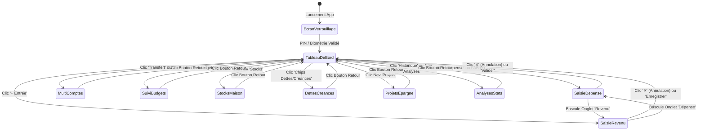
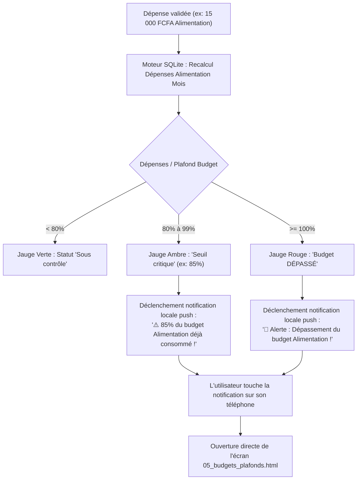

# Spécification Détaillée des Flux Utilisateurs (User Flows) — GERETOU
**Parcours Chronologiques, Événements Déclencheurs et Transitions Conditionnelles**

---

## 1. Vue d'Ensemble des Transitions d'Écrans

---

## 2. Flux 0 : Authentification Sécurisée & Déverrouillage

* **Point d'entrée** : L'utilisateur ouvre l'application ou réveille l'écran après un délai d'inactivité de 3 minutes.
* **Écran affiché** : Clavier sécurisé PIN + invite biométrique.
* **Déroulement chronologique** :
  1. L'application vérifie si un prompt biométrique (Face ID / Empreinte) est configuré. Si oui, il est sollicité automatiquement.
  2. En cas de non-utilisation de la biométrie, l'utilisateur tape son code PIN à 4 ou 6 chiffres sur un pavé numérique dont les touches n'ont aucun effet de rétention visuelle non sécurisée.
  3. Chaque chiffre tapé remplit une pastille de confirmation.
* **Branchements conditionnels** :
  * **Cas Nominal (Code Valide)** : La clé de déchiffrement SQLite est libérée, animation fluide et transition immédiate vers le **Tableau de Bord**.
  * **Cas Erreur (Code Incorrect)** :
    * Les pastilles s'illuminent en rouge avec animation de tremblement (*shake* haptique).
    * Compteur de tentatives incrémenté.
    * À la 3ème tentative infructueuse : blocage temporaire de 30 secondes avec compte à rebours visible.
  * **Cas Oubli du PIN** : Lien *« Code oublié ? »* déclenchant une procédure de réinitialisation sécurisée par e-mail ou clé de secours hors-ligne.

---

## 3. Flux 1 : Saisie Express d'une Dépense (Fast 3-Clicks)

* **Objectif** : Enregistrer un achat en moins de 5 secondes au marché ou dans les transports.
* **Point d'entrée** : Clic sur le bouton `+ Dépense` de la carte solde ou sur le bouton central flottant `FAB (+)` du menu inférieur.
* **Déroulement chronologique** :
  1. **Étape 1 : Montant**
     * Le curseur est positionné par défaut sur le champ montant.
     * L'utilisateur peut soit taper les chiffres, soit appuyer sur les puces d'incrément rapide : `+1 000`, `+5 000`, `+10 000`, `+25 000 FCFA`.
     * Le montant s'affiche en typographie très contrastée (`text-4xl`).
  2. **Étape 2 : Compte source & Catégorie**
     * Le compte actif par défaut est le dernier utilisé (ex : *Wave* avec son solde de 150 000 FCFA). L'utilisateur peut toucher un autre portefeuille (MoMo, Cash, Banque) en un clic.
     * L'utilisateur touche une tuile de catégorie (ex : *Alimentation & Marché*). La tuile passe en fond vert émeraude avec une coche active.
  3. **Étape 3 : Validation**
     * Le bouton inférieur sticky affiche dynamiquement la somme : *« Valider la dépense (15 000 FCFA) »*.
     * L'utilisateur clique sur le bouton.
* **Exécution système en arrière-plan** :
  * Transaction ACID SQLite :
    1. Insertion de la ligne dans `transactions`.
    2. Décrémentation du solde du compte Wave (`150 000 - 15 000 = 135 000 FCFA`).
    3. Mise à jour des cumuls de budget du jour et du mois.
    4. Enregistrement de l'action dans `sync_queue` pour réplication Cloud ultérieure.
* **Retour visuel** :
  * Vibration haptique légère de confirmation.
  * Toast de succès : *« ✓ Dépense de 15 000 FCFA enregistrée »*.
  * Redirection automatique vers le Tableau de Bord où le nouveau solde est déjà actualisé.

---

## 4. Flux 2 : Nouveau Revenu & Application des Règles Comptables

* **Point d'entrée** : Clic sur le bouton `+ Entrée` de la carte de solde.
* **Déroulement chronologique** :
  1. L'utilisateur saisit le montant encaissé (ex: `+250 000 FCFA`).
  2. L'utilisateur sélectionne obligatoirement la **Provenance de l'argent** parmi les tuiles :
     * *Salaire*
     * *Prestation / Freelance*
     * *Vente d'un bien*
     * *Don / Cadeau*
     * *Crédit / Emprunt*
     * *Autre*
  3. **Branchement conditionnel strict selon la provenance** :
     * **Si l'utilisateur choisit *Crédit / Emprunt*** :
       * Un bandeau d'alerte ambre apparaît immédiatement sous la tuile :
         > ⚠️ **Note Comptable Rapprochée** : Un emprunt n'est pas un gain d'exploitation. Cette somme sera enregistrée dans votre module **Dettes** à rembourser et n'augmentera pas votre revenu net d'activité.
       * Le système demande la saisie de l'échéance et du créancier prêteur.
     * **Si l'utilisateur choisit *Salaire / Prestation / Don / Vente*** :
       * L'utilisateur peut activer l'option : *« Allouer une partie à un projet d'épargne »*.
       * Sélection du pourcentage (ex : 15 %) et du coffre cible (ex : *Projet PC*).
  4. L'utilisateur clique sur *« Enregistrer le revenu (+250 000 FCFA) »*.
* **Exécution système** :
  * Le solde du compte récepteur est crédité.
  * Si une part d'épargne a été allouée, un virement automatique est généré vers le sous-compte coffre verrouillé.

---

## 5. Flux 3 : Suivi Budgétaire & Alertes de Seuil Déclenchées Hors-Ligne

---

## 6. Flux 4 : Stocks Domestiques & Courses Automatiques

* **Point d'entrée** : Navigation vers l'onglet **Stocks**.
* **Déroulement chronologique** :
  1. L'utilisateur consulte la liste des denrées du foyer.
  2. Chaque article affiche sa jauge et son badge :
     * *Riz 25kg* : 2 kg restants $\rightarrow$ Badge ambre **Stock bas** (seuil = 5 kg).
     * *Huile Dinor* : 0 L restants $\rightarrow$ Badge rouge **Rupture totale**.
     * *Savon* : 8 morceaux $\rightarrow$ Badge vert **Stock suffisant**.
  3. L'application affiche en tête de page un bandeau d'action : *« 4 produits nécessitent un réapprovisionnement immédiat »*.
  4. L'utilisateur clique sur *« 📋 Voir le panier de courses auto »*.
  5. L'écran filtre automatiquement et isole uniquement les articles en rupture ou stock bas, avec case à cocher et calcul du total estimé (18 500 FCFA).
  6. Au retour du marché, l'utilisateur coche les articles achetés et valide :
     * Les stocks se réincrémentent instantanément.
     * Une dépense réelle est créée dans le module Dépenses avec le portefeuille sélectionné.

---

## 7. Flux 5 : Dettes, Créances & Remboursements Partiels

* **Point d'entrée** : Clic sur le lien *« On vous doit »* ou *« Vous devez »* du tableau de bord.
* **Scénario : Remboursement partiel d'une créance** :
  1. L'utilisateur consulte l'onglet *Créances* : Moussa K. (prêt initial de 30 000 FCFA, solde restant 20 000 FCFA).
  2. Moussa effectue un versement partiel de 10 000 FCFA par Wave.
  3. L'utilisateur clique sur la ligne de Moussa, puis sur *« Encaisser remboursement »*.
  4. Saisie du montant : `10 000 FCFA`, compte récepteur : `Wave`.
  5. Validation :
     * Le solde Wave de l'utilisateur est augmenté de 10 000 FCFA.
     * Le reste dû de Moussa est ramené à 10 000 FCFA.
     * La transaction est historisée dans le journal de la créance.

---

## 8. Flux 6 : Virement Interne Mobile Money (Wave $\leftrightarrow$ MoMo)

* **Objectif** : Déplacer de la trésorerie entre portefeuilles sans créer de fausses dépenses ni de faux gains.
* **Point d'entrée** : Écran *Portefeuilles* $\rightarrow$ Clic sur *« ⇄ Virement Interne »*.
* **Déroulement** :
  1. Sélection du compte débité : *Wave Principal* (Solde actuel : 150 000 FCFA).
  2. Sélection du compte crédité : *MTN MoMo* (Solde actuel : 120 000 FCFA).
  3. Saisie du montant transféré : `25 000 FCFA`.
  4. Saisie facultative des frais de transfert (ex: 250 FCFA) :
     * Si des frais existent, ils sont comptabilisés comme une dépense réelle dans la catégorie *Frais bancaires & commissions*.
     * Le montant principal (25 000 FCFA) reste strictement neutre.
  5. Clic sur *« Exécuter le transfert »*.
* **Résultat** :
  * Wave passe à 124 750 FCFA (avec 250 F de frais).
  * MoMo passe à 145 000 FCFA.
  * Les statistiques budgétaires mensuelles ne sont pas polluées.
